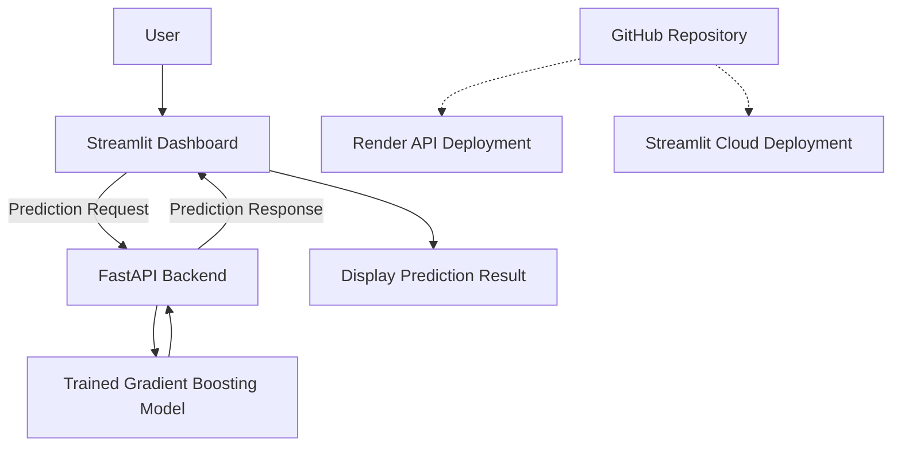
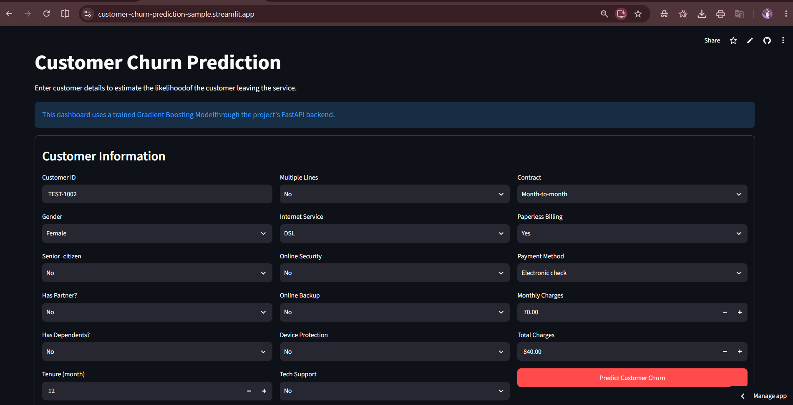
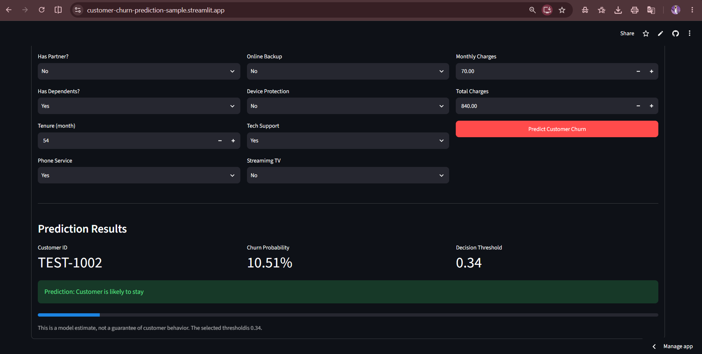
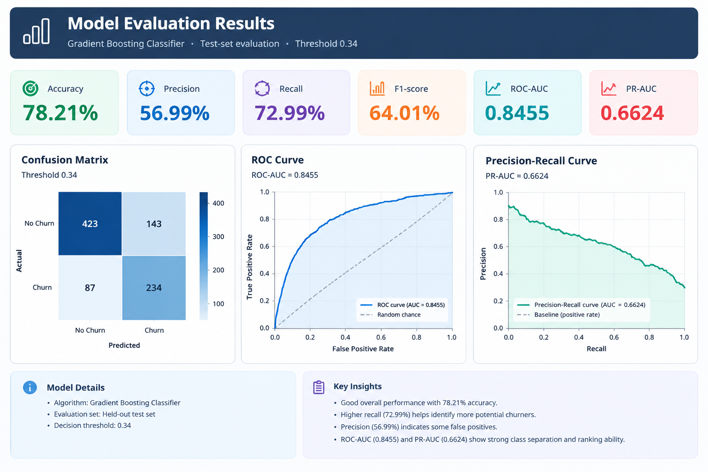

# Customer Churn Prediction System

An end-to-end machine learning application that predicts customer churn using a trained Gradient Boosting model. The project includes an interactive Streamlit dashboard and a FastAPI backend deployed as public web services.

## Live Demo

- **Dashboard:** https://customer-churn-prediction-sample.streamlit.app/
- **Backend API:** https://customer-churn-prediction-api-oa7c.onrender.com
- **API Documentation:** https://customer-churn-prediction-api-oa7c.onrender.com/docs

## Project Overview

Customer churn prediction helps businesses identify customers who may stop using their services. This project demonstrates a complete machine learning workflow, from model evaluation to API development and cloud deployment.

## Key Features

- Interactive customer churn prediction dashboard
- REST API built with FastAPI
- Trained Gradient Boosting classification model
- Model evaluation using multiple classification metrics
- Health-check endpoint for API availability
- Public cloud deployment of the dashboard and backend

## Technology Stack

- **Language:** Python
- **Data Processing:** Pandas, NumPy
- **Machine Learning:** Scikit-learn
- **Model Persistence:** Joblib
- **Backend:** FastAPI, Uvicorn
- **Dashboard:** Streamlit
- **Testing:** Pytest
- **Deployment:** Streamlit Community Cloud, Render
- **Version Control:** Git, GitHub

## System Architecture



## Screenshots

### Dashboard


### Prediction Result


### API Documentation

```


## Model Evaluation

The model was evaluated using a held-out test set at a classification threshold of 0.34.

| Metric | Score |
|---|---:|
| Accuracy | 78.21% |
| Precision | 56.99% |
| Recall | 72.99% |
| F1-score | 64.01% |
| ROC-AUC | 84.55% |
| PR-AUC | 66.24% |

These results illustrate the trade-off between identifying potential churners and avoiding false-positive predictions. Performance may vary with new data.

## Run Locally

### 1. Clone the repository

```bash
git clone https://github.com/goudalija44-cloud/customer-churn-prediction.git
cd customer-churn-prediction
```

### 2. Create and activate a virtual environment

On Windows CMD:

```bash
python -m venv .venv
.venv\Scripts\activate
```

### 3. Install dependencies

```bash
python -m pip install -r requirements.txt
```

### 4. Start the API

```bash
python -m uvicorn api.main:app --reload
```

Open the interactive API documentation at:

http://127.0.0.1:8000/docs

### 5. Start the dashboard

Open a second terminal, activate the same virtual environment, and run:

```bash
python -m streamlit run dashboard/app.py
```

The dashboard will display a local URL in the terminal.

## Testing

Run the automated tests from the project root:

```bash
python -m pytest -v
```

## Project Structure

```text
customer-churn-prediction/
├── api/
│   └── main.py
├── dashboard/
│   └── app.py
├── data/
├── models/
├── src/
├── tests/
│   └── test_api.py
├── requirements.txt
├── .gitignore
└── README.md
```

## Limitations

- Predictions depend on the quality and representativeness of the training data.
- Model performance can change when customer behavior or data distributions change.
- Predictions are estimates, not guarantees that a customer will churn.
- The project is a portfolio demonstration and should be validated on relevant business data before real-world use.

## Future Improvements

- Add model monitoring and data-drift detection.
- Compare additional classification models.
- Improve explainability with feature-importance analysis.
- Add automated retraining and model versioning.
- Expand the test suite and prediction monitoring.

## Author

Computer Science student interested in Machine Learning, AI Engineering, and data-driven applications.
